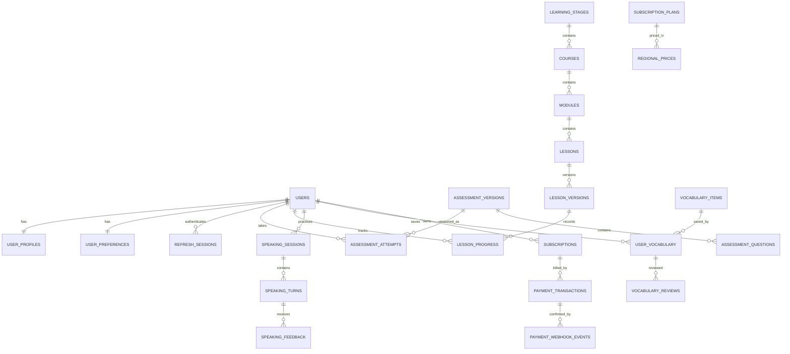

# Gabenglish Database ERD and Relationship Specification

Version 1.0 — logical relationship contract for the initial PostgreSQL implementation.

## 1. Entity groups

### Identity
- users 1:1 user_profiles
- users 1:1 user_preferences
- users 1:N refresh_sessions
- users 1:N consent_records

### Curriculum
- proficiency_levels 1:N learning_stages
- learning_stages 1:N courses
- courses 1:N modules
- modules 1:N lessons
- lessons 1:N lesson_versions
- lesson_versions 1:N lesson_activities
- lesson_versions 1:N lesson_prerequisites (source lesson version to prerequisite lesson version)

Published lesson versions are immutable. A lesson points to a current published version; editing creates a new draft/version.

### Learning and assessment
- users 1:N assessment_attempts
- assessment_versions 1:N assessment_attempts
- assessment_versions 1:N assessment_questions
- assessment_questions 1:N assessment_options
- users 1:N lesson_progress
- lesson_versions 1:N lesson_progress
- users 1:N exercise_attempts
- lesson_activities 1:N exercise_attempts
- users 1:N learner_skill_profiles
- learner_skill_profiles 1:N skill_evidence
- users 1:N stage_transition_evidence

### Vocabulary and practice
- vocabulary_items 1:N vocabulary_examples
- vocabulary_items 1:N vocabulary_translations
- users N:M vocabulary_items through user_vocabulary
- user_vocabulary 1:N vocabulary_reviews
- users 1:N practice_attempts

### Speaking and AI
- users 1:N speaking_sessions
- speaking_sessions 1:N speaking_turns (unique session + sequence)
- speaking_turns 1:N speaking_feedback
- speaking_sessions 1:N ai_usage_records
- ai_provider_configs 1:N ai_usage_records

### Media and consent
- users 1:N media_assets
- users 1:N consent_records
- media_assets N:1 consent_records where a recording requires consent
- media_assets 1:N media_access_audit (restricted access only)

### Commerce and administration
- subscription_plans 1:N regional_prices
- users 1:N subscriptions
- subscriptions 1:N payment_transactions
- payment_transactions 1:N payment_webhook_events (provider event id unique)
- users 1:N admin_audit_events where the user is the affected subject
- admin_accounts N:M admin_roles through admin_account_roles

## 2. Relationship rules
- Every learner-owned row carries user_id or is reachable through a parent with an enforced ownership check.
- Never trust a client-supplied user_id for learner operations; derive it from the authenticated principal.
- Use RESTRICT for published curriculum referenced by attempts/progress and financial records.
- Use soft deletion or anonymisation workflows for user identity; retain only legally required financial/audit data under a documented retention schedule.
- Child rows may cascade only where deletion is safe and does not erase evidence or financial records.
- Use unique constraints for user+lesson progress, user+vocabulary item, session+turn sequence, provider+webhook event id.
- Store timestamps in timestamptz and write UTC instants.
- Keep raw audio separate from transcripts and derived feedback; apply consent and expiry rules independently.

## 3. Mermaid ER diagram

## 4. Implementation note
This ERD is the logical contract. The accompanying SQL migration is an initial foundation, not the entire final product schema. Extend through reviewed migrations; do not silently change published content or financial history.
